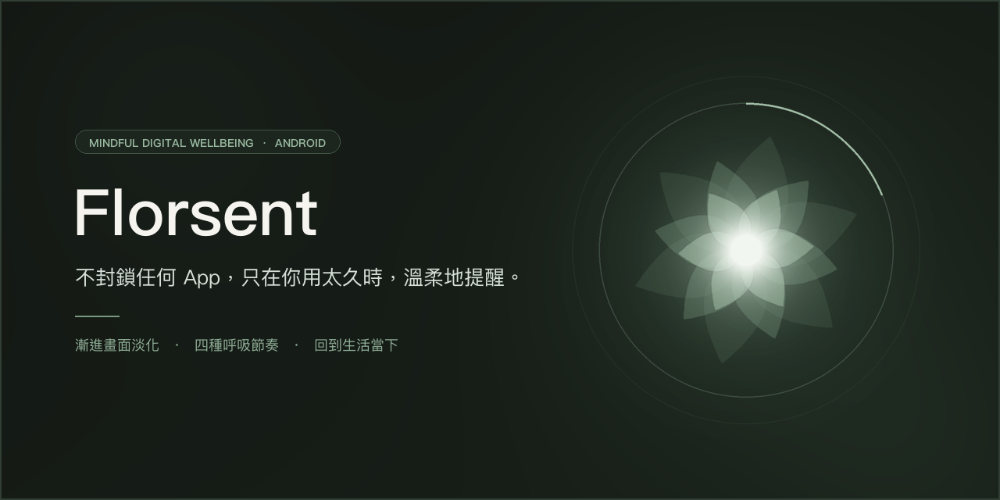

  

# Florsent

Florsent 是一個幫你慢慢放下手機的 Android App。

它不會封鎖任何 App，也不會對你說教。只有在你滑社群滑得比自己預期還久的時候，畫面才會一點一點變淡，輕輕問你一句：「停下來深呼吸一下？」

## 為什麼這樣設計

很多人都試過「限制使用時間」的 App。時間一到，App 被鎖住，然後我們做的第一件事，通常是找方法解鎖。

Florsent 想試試另一種方式。比起被擋住，我們更相信被溫柔地提醒。當畫面慢慢失去顏色，滑動也就沒那麼吸引人；這時候如果有人輕聲問你要不要休息一下，停下來會變得容易許多。

要不要停，永遠由你決定。

## 三個時刻

  

### 一、溫柔漸進提醒

你可以設定每次能在社群 App 上待多久，以及一天總共多久。用超過的時候，畫面會在幾分鐘內慢慢變淡，接著畫面下方浮出一句小小的提醒：「停下來深呼吸一下？」

不想停也沒關係，按一下「✕」，提醒會晚一點再出現。

### 二、沉浸呼吸練習

點一下提醒，就會直接進入呼吸練習。畫面中央有一朵蓮花，吸氣時慢慢展開，吐氣時輕輕收合，你只要跟著它就好。整段練習大約一分多鐘，換階段時手機會輕輕震一下。想聽輕柔的手碟聲或提示鈴聲，也可以自己打開。

### 三、回到生活當下

練習結束後，Florsent 會留給你一句簡單的話，例如「感受雙腳踩在地上的重量」或「放下手機，去倒杯水，慢慢喝完」。按下「回到生活」，畫面恢復原本的樣子；接下來的一段安靜時間裡，Florsent 不會再提醒你。

## 四種呼吸法，什麼時候用

| 呼吸法 | 節奏 | 適合的時候 |
|---|---|---|
| **等長呼吸** | 吸氣 4 秒、屏息 4 秒、吐氣 4 秒 | 想讓腦袋清楚一點，準備開始做事的時候 |
| **盒式呼吸** | 吸氣、屏息、吐氣、停頓，各 4 秒 | 心裡有點亂、有點焦躁，想先穩定下來的時候 |
| **4-7-8 放鬆呼吸** | 吸氣 4 秒、屏息 7 秒、吐氣 8 秒 | 睡前，或想讓身體放鬆的時候。最多 4 輪 |
| **共振呼吸** | 吸氣、吐氣各 5.5 秒 | 不知道選哪一個的時候。節奏平穩，很適合當作每天的習慣 |

如果練習時覺得頭暈或不舒服，就停下來，恢復平常的呼吸。呼吸練習是幫助放鬆的小習慣，不能取代醫療或專業的心理照護。

## 你可以自己決定的事

- **要留意哪些 App**：只有你選的 App 會計算時間。第一次使用時，Florsent 會先幫你勾選手機上常見的社群 App。
- **額度有多長**：每次可以用多久、一天總共多久、完成練習後要安靜多久，都可以調整。
- **聲音**：環境音和提示鈴聲預設都是關的，在公共場合也不會突然出聲。
- **練完之後去哪裡**：可以直接回到手機桌面，也可以留在 Florsent。
- **配色**：喜歡和手機桌布一致的顏色？可以開啟「跟隨系統主題色」，讓 Florsent 換上你的桌布配色。
- **讓畫面變成黑白**：較新的手機可以選擇在畫面淡到底時，整個變成黑白。這是選用功能，預設關閉。
- **讓 App 自己慢慢褪色（進階）**：如果你熟悉手機設定，可以另外安裝一個叫 Shizuku 的小工具。開啟後，只有你正在用的那個 App 會從彩色慢慢變成黑白，其他畫面不受影響。離開那個 App、完成呼吸練習或關掉這個選項時，顏色都會立刻恢復。

第一次想看看會發生什麼事？首頁有一個「30 秒體驗漸進引導」，不用真的等到超過時間，就能完整體驗一次。

## 我們對隱私的承諾

- Florsent 只需要知道「你現在正在用哪個 App」，用來計算時間。它看不到你的訊息、看不到畫面上的內容，也不會記錄你輸入的任何文字。
- 所有資料都只存在你的手機裡。Florsent 沒有連網功能，不會上傳、不會備份到雲端，也不會分享給任何人。
- App 裡沒有廣告，也沒有任何追蹤工具。
- 不想用了，解除安裝就會把資料全部刪除。

完整內容請見[隱私權政策](PRIVACY.md)。

## 常見問題

### Florsent 會封鎖我的 App 嗎？

不會。Florsent 只會讓畫面慢慢變淡，再輕輕提醒你。你隨時都可以繼續使用任何 App。

### 為什麼要開啟「無障礙服務」？

這是 Android 讓 Florsent 知道「你正在用哪個 App」，並在畫面上顯示淡化效果的方法。Florsent 只用它來做這兩件事，看不到畫面內容，也不會代替你操作手機。開啟前，App 會先完整說明，你同意之後才會帶你去設定。

### 會不會很耗電？

不會。手機螢幕關閉，或你沒有在用選定的 App 時，Florsent 完全不會在背景工作。

### 畫面變淡的時候，我可以先不理它嗎？

可以。按提醒旁邊的「✕」，提醒會晚一點再出現。畫面會繼續變淡，但不會擋住你。

### 每天的額度用完了會怎樣？

之後每次打開選定的 App，會先讓你用 2 分鐘，畫面才開始慢慢變淡。比平常早一點提醒，但不會一打開就被擋住。每天午夜會重新計算。

### 練習做到一半想停下來呢？

按「提早結束」就好。如果直接離開練習、回到社群 App，畫面會回到原本淡化的程度。

### 換新手機的話，設定會跟著過去嗎？

不會。為了讓資料真的只留在這支手機上，Florsent 不使用雲端備份。在新手機上重新設定一次就好，只要一分鐘。

### 怎麼停用 Florsent？

在手機的「設定 > 無障礙」中關閉「Florsent 漸進引導」即可。想刪除所有資料，直接解除安裝 Florsent。

## 想知道更多

- [技術文件](docs/TECHNICAL.md)：架構、三層漸進灰階、效能與省電、編譯與測試。給開發者與協助開發的 AI agent。
- [隱私權政策](PRIVACY.md)：中文與英文。
- [參與貢獻](CONTRIBUTING.md)：回報問題、提出想法或送出程式碼。
- 授權：[Apache License 2.0](LICENSE)

---

  慢慢放下手機就好。

