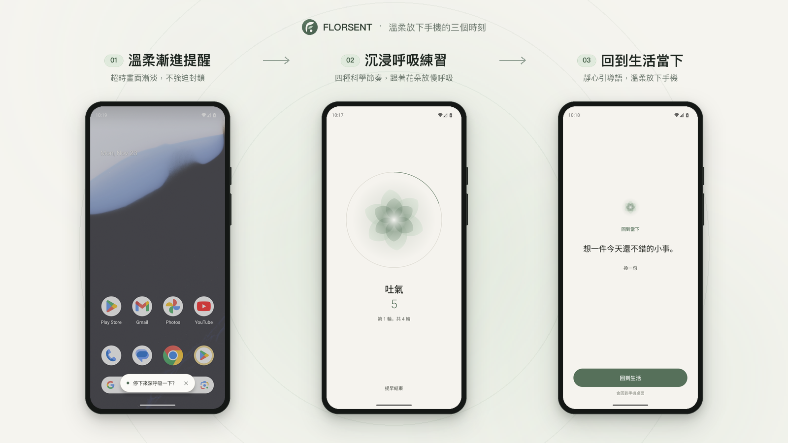

  

# Florsent

Florsent 是一個幫你慢慢放下手機的 Android App。

它不會封鎖任何 App，也不會對你說教。只有在你滑社群滑得比自己預期還久的時候，畫面才會一點一點變淡，輕輕問你一句：「停下來深呼吸一下？」

## 為什麼這樣設計

很多人都試過「限制使用時間」的 App。時間一到，App 被鎖住，然後我們做的第一件事，通常是找方法解鎖。

Florsent 想試試另一種方式。比起被擋住，我們更相信被溫柔地提醒。當畫面慢慢失去顏色，滑動也就沒那麼吸引人；這時候如果有人輕聲問你要不要休息一下，停下來會變得容易許多。

要不要停，永遠由你決定。

## 三個時刻

  

### 一、溫柔漸進提醒

你可以設定每次能在社群 App 上待多久，以及一天總共多久。用超過的時候，畫面會在幾分鐘內慢慢變淡，接著畫面下方浮出一句小小的提醒：「停下來深呼吸一下？」

不想停也沒關係，按一下「✕」，提醒會晚一點再出現。

如果打開「變淡時播放柔和雨聲」，畫面開始變淡時，遠遠的雨聲和晚風會跟著慢慢浮現。你正在看的影片不會被暫停，只會暫時變小聲。

### 二、沉浸呼吸練習

點一下提醒，就會直接進入呼吸練習。畫面中央有一朵蓮花，吸氣時慢慢展開，吐氣時輕輕收合，你只要跟著它就好。整段練習大約一分多鐘，換階段時手機會輕輕震一下。想聽溫暖的頌缽長音或提示鈴聲，也可以自己打開。

### 三、回到生活當下

練習結束後，Florsent 會留給你一句簡單的話，例如「感受雙腳踩在地上的重量」或「放下手機，去倒杯水，慢慢喝完」。按下「回到生活」，畫面恢復原本的樣子；接下來的一段安靜時間裡，Florsent 不會再提醒你。

## 睡前，慢慢放下手機

很多人最難放下手機的時候是睡前。Florsent 會先觀察一週，看你通常幾點放下手機。看得出規律時，首頁會問你一次：「最近你多在 23:40 左右放下手機，要在那之前溫和提醒你嗎？」你答應之後，時間就固定下來，不會跟著你每晚的狀況偷偷移動。

從這個時間的 30 分鐘前開始，在留意的 App 上累計滑超過 15 分鐘，畫面就會慢慢變淡，提醒換成「該準備休息了嗎？」。點下去會直接進入 4-7-8 放鬆呼吸，結束時的按鈕是「去休息吧」。一個晚上最多提醒兩次，之後只會讓畫面變淡，不再打擾你。

作息不規律、或想自己決定？隨時可以在「設定 > 睡前引導」選一個時間，也可以把可以滑多久改成 10 或 20 分鐘，或者整個關掉。

## 看看最近的自己

點首頁的「今天在社群 App 上」卡片，可以看到今天、近 7 天和最常用的 App。上方會用一兩句話說說你最近的樣子，例如「最近多在 23:40 左右放下手機」或「這週比上週少滑了 1 小時」。沒有評分，也沒有排名。

## 四種呼吸法，什麼時候用

| 呼吸法 | 節奏 | 適合的時候 |
|---|---|---|
| **等長呼吸** | 吸氣 4 秒、閉氣 4 秒、吐氣 4 秒 | 想讓腦袋清楚一點，準備開始做事的時候 |
| **盒式呼吸** | 吸氣、閉氣、吐氣、停頓，各 4 秒 | 心裡有點亂、有點焦躁，想先穩定下來的時候 |
| **4-7-8 放鬆呼吸** | 吸氣 4 秒、閉氣 7 秒、吐氣 8 秒 | 睡前，或想讓身體放鬆的時候。最多 4 輪 |
| **共振呼吸** | 吸氣、吐氣各 5.5 秒 | 不知道選哪一個的時候。節奏平穩，很適合當作每天的習慣 |

如果練習時覺得頭暈或不舒服，就停下來，恢復平常的呼吸。呼吸練習是幫助放鬆的小習慣，不能取代醫療或專業的心理照護。

## 你可以自己決定的事

- **要留意哪些 App**：只有你選的 App 會計算時間。第一次使用時，Florsent 會先幫你勾選手機上常見的社群 App。
- **額度有多長**：每次可以用多久、一天總共多久、完成練習後要安靜多久，都可以調整。
- **睡前提醒**：用學到的時間、自己選一個時間，或者不要。
- **要不要記錄使用時段**：學習作息和顯示洞察需要在手機上保存 30 天的使用紀錄。可以隨時關閉，或一鍵清除。
- **聲音**：呼吸練習的頌缽長音、變淡時的柔和雨聲和提示鈴聲，預設都是關的，在公共場合也不會突然出聲。通話中不會播放。
- **練完之後去哪裡**：可以直接回到手機桌面，也可以留在 Florsent。
- **配色**：喜歡和手機桌布一致的顏色？可以開啟「跟隨系統主題色」，讓 Florsent 換上你的桌布配色。
- **讓畫面變成黑白**：較新的手機可以選擇在畫面淡到底時，整個變成黑白。這是選用功能，預設關閉。
- **讓 App 自己慢慢褪色（進階）**：如果你熟悉手機設定，可以另外安裝一個叫 Shizuku 的小工具。開啟後，只有你正在用的那個 App 會從彩色慢慢變成黑白，其他畫面不受影響。離開那個 App、完成呼吸練習或關掉這個選項時，顏色都會立刻恢復。

第一次想看看會發生什麼事？首頁有一個「30 秒體驗漸進引導」，不用真的等到超過時間，就能完整體驗一次。

## 我們對隱私的承諾

- Florsent 只需要知道「你現在正在用哪個 App」，用來計算時間。它看不到你的訊息、看不到畫面上的內容，也不會記錄你輸入的任何文字。
- 你同意後，Florsent 會在手機上保存 30 天的使用時段（留意的 App 用了多久、螢幕什麼時候亮著），用來學習作息。學習在手機上完成，不用雲端，也不用 AI 模型。隨時可以在設定裡清除。
- 所有資料都只存在你的手機裡。Florsent 沒有連網功能，不會上傳、不會備份到雲端，也不會分享給任何人。
- App 裡沒有廣告，也沒有任何追蹤工具。
- 不想用了，解除安裝就會把資料全部刪除。

完整內容請見[隱私權政策](PRIVACY.md)。

## 常見問題

### Florsent 會封鎖我的 App 嗎？

不會。Florsent 只會讓畫面慢慢變淡，再輕輕提醒你。你隨時都可以繼續使用任何 App。

### 為什麼要開啟「無障礙服務」？

這是 Android 讓 Florsent 知道「你正在用哪個 App」，並在畫面上顯示淡化效果的方法。Florsent 只用它來做這兩件事，看不到畫面內容，也不會代替你操作手機。開啟前，App 會先完整說明，你同意之後才會帶你去設定。

### 會不會很耗電？

不會。手機螢幕關閉，或你沒有在用選定的 App 時，Florsent 完全不會在背景工作。

### 畫面變淡的時候，我可以先不理它嗎？

可以。按提醒旁邊的「✕」，提醒會晚一點再出現。畫面會繼續變淡，但不會擋住你。

### 每天的額度用完了會怎樣？

之後每次打開選定的 App，會先讓你用 2 分鐘，畫面才開始慢慢變淡。比平常早一點提醒，但不會一打開就被擋住。每天午夜會重新計算。

### 練習做到一半想停下來呢？

按「提早結束」就好。如果直接離開練習、回到社群 App，畫面會回到原本淡化的程度。

### 換新手機的話，設定會跟著過去嗎？

不會。為了讓資料真的只留在這支手機上，Florsent 不使用雲端備份。在新手機上重新設定一次就好，只要一分鐘。

### Florsent 怎麼知道我幾點睡？

它不知道你幾點睡，只知道你晚上通常幾點放下手機：找出每晚螢幕關著最久的那一段，從哪裡開始。半夜看一下鬧鐘、回一則訊息（10 分鐘以內）不會被當成醒來。開著影片睡著、或手機重開機那幾晚看不準，就直接跳過，不會亂猜。

### 我的作息很不規律，或是輪班，怎麼辦？

觀察一週後如果看不出規律，首頁會改成邀請你自己選一個時間。你也可以完全不用睡前引導，其他功能照常運作。

### 怎麼停用 Florsent？

在手機的「設定 > 無障礙」中關閉「Florsent 漸進引導」即可。想刪除所有資料，直接解除安裝 Florsent。

## 想知道更多

- [技術文件](docs/TECHNICAL.md)：架構、三層漸進灰階、效能與省電、編譯與測試。給開發者與協助開發的 AI agent。
- [隱私權政策](PRIVACY.md)：中文與英文。
- [參與貢獻](CONTRIBUTING.md)：回報問題、提出想法或送出程式碼。
- [Google Play 上架資料](docs/PLAY_STORE.md)：商店介紹、資料安全表單、無障礙服務聲明。
- 授權：[Apache License 2.0](LICENSE)

## 特別感謝

謝謝 **[liball（@liballouo）](https://github.com/liballouo)**。

2025 年初 Florsent 還只是一個雛形的時候，liball 就一起動手：做了滾輪式的時間選擇器，一次次調整到滾輪能好好對齊，還畫了 Florsent 的第一個 App 圖示。那段時間的程式碼保存在 `archive/liball` 標籤裡。現在的 Florsent 換了新的樣子，但最早一起把它做出來的心意，一直都在。

---

  慢慢放下手機就好。

